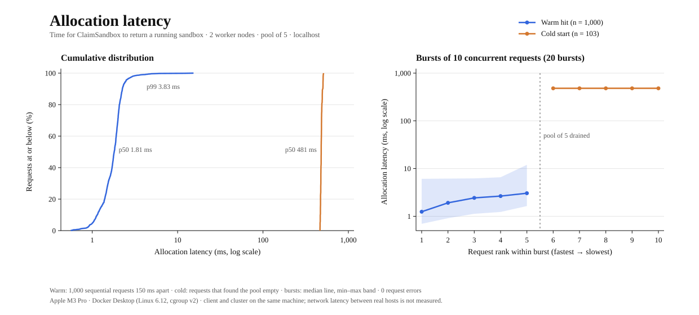
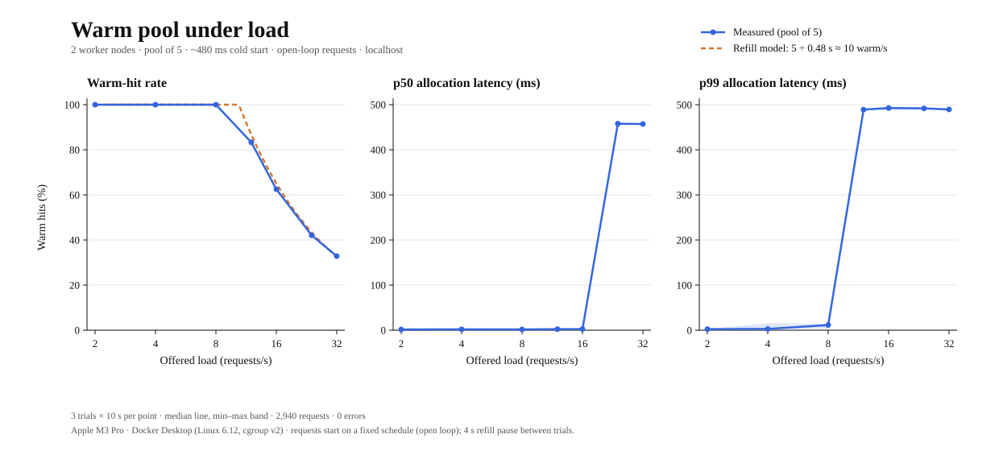

# ZeroBoot

A distributed warm pool of isolated Linux sandboxes, written in Go and gRPC.

Starting a fresh execution environment is slow: a new Python container that imports numpy and pandas takes a measured **~450ms** ([baseline](docs/cold-start-baseline.md)). ZeroBoot does that work ahead of time. Worker nodes pre-spawn sandbox processes, freeze them at 0% CPU with cgroup v2, and park them in the controller's warm pool. A request thaws one instead of starting one, which brings allocation down to **1.8ms p50 / 3.8ms p99**, compared with ~480ms for a cold start.

## Architecture


Thin arrows are the **control plane** (gRPC). Thick arrows are the **data plane**: the gateway streams each task straight to its sandbox over a raw TCP socket, so payloads never pass through the controller.

| Component | Role |
|---|---|
| [`cmd/gateway`](cmd/gateway) | HTTP entry point. Claims a sandbox, streams the task over TCP (`TCP_NODELAY`, keepalive), releases it, returns JSON metrics. |
| [`cmd/controller`](cmd/controller) | Owns the warm pool, a buffered Go channel of 5 frozen sandboxes. Refills it in the background, round-robin across nodes, and destroys leases held longer than 10s. |
| [`cmd/node-agent`](cmd/node-agent) | Runs on each worker. Spawns sandboxes in new PID and UTS namespaces, puts each in its own cgroup, and freezes, thaws or kills it on request. |
| [`cmd/sandbox`](cmd/sandbox) | The workload. Simulates a 450ms cold start, then answers one line of input per line over TCP. |

## Getting started

Requires Docker with cgroup v2 (Docker Desktop or any recent Linux). The benchmarks also need `curl`, `jq` and `python3`.

```sh
docker compose up --build -d     # or: make up
curl -s -X POST localhost:8080/execute -d '{"payload": "hello"}'
```

```json
{"sandbox_id":"4ce4c231","node":"node-1","status":"WARM_HIT","allocation_latency_ms":1.354,"output":"sandbox=4ce4c231 pid=1 result=HELLO"}
```

`pid=1` shows that the sandbox runs in its own PID namespace. Add `?simulate_hang=true` to skip the release, and the controller's cleanup loop destroys the sandbox about 10s later.

```sh
docker compose logs -f controller   # WARM_HIT / COLD_MISS, refills, expiries
docker compose down                 # or: make down
```

Set `GATEWAY_PORT` to publish the gateway on a port other than 8080.

## Performance

All numbers come from the four-container Compose cluster on one laptop (Apple M3 Pro, Docker Desktop with Linux 6.12 and cgroup v2). Raw data: [results.csv](docs/benchmark/results.csv) and [sweep.csv](docs/benchmark/sweep.csv).

| Allocation latency | n | p50 | p95 | p99 | max |
|---|---:|---:|---:|---:|---:|
| **Warm hit** (paced, steady state) | 1,000 | 1.81 ms | 2.48 ms | 3.83 ms | 15.37 ms |
| **Cold start** (pool empty) | 103 | 480.5 ms | 505.2 ms | 508.8 ms | 512.6 ms |

### Warm hits vs cold starts



A warm hit is a gRPC round trip plus a write to `cgroup.freeze`, and 99% of them finish in under 4ms. A burst larger than the pool never fails: in every 10-request burst, the first five got warm sandboxes, and the other five fell back to cold starts while the pool refilled.

### Under sustained load



Up to 8 requests per second, every request was a warm hit, with p99 under 10ms. Beyond about 10 per second, the pool can't refill fast enough. One refill takes ~480ms and at most 5 run at once, so the pool supplies about 5 ÷ 0.48 s ≈ 10 warm sandboxes per second.

The measured warm-hit rate follows that model closely: 83% at 12/s, 62.5% at 16/s and 32.5% at 32/s. p99 jumps to cold-start latency as soon as some requests miss (12/s), and p50 follows once fewer than half are warm (24/s). All 2,940 requests in the sweep succeeded. Every request is still served at any load; a larger pool or faster refill would move the point where cold starts begin.

## Testing

`scripts/benchmark.sh` (or `make bench`) checks the cluster end to end, prints PASS or FAIL for each check, and exits non-zero if any check fails:

| Check | Last run |
|---|---|
| 5 rapid requests are all `WARM_HIT` with allocation under 5ms | PASS (1.2–1.5ms) |
| 3 requests right after them, with the pool drained, are all `COLD_MISS` at 400–1000ms | PASS (~472ms) |
| A `simulate_hang` lease is destroyed by the TTL cleanup between 10s and 13s | PASS (11.9s) |
| Every sandbox the workers created used a real cgroup, not the signal fallback | PASS (1,215 of 1,215) |
| No request failed | PASS (0 errors) |

`SAMPLES`, `INTERVAL` and `BURSTS` shorten or lengthen the run, for example `SAMPLES=50 BURSTS=2 ./scripts/benchmark.sh` for a quick check.

The code also builds and vets cleanly on macOS, where the Linux-only isolation is replaced by a stub:

```sh
make build && make vet
```

There are no Go unit tests yet. During development, the controller was also run under Go's race detector against overlapping claims, releases and expiries, which found no races.

## Limitations

- **This is a simulation.** The sandbox fakes its startup with a 450ms sleep and "runs" a task by uppercasing it; no real code executes. The processes, namespaces, cgroups, gRPC calls and TCP streams are real.
- **The isolation is not a security boundary.** PID and UTS namespaces and a freezer cgroup aren't enough; there is no seccomp, user namespace or filesystem isolation. Worker containers also run privileged.
- **The controller is a single point of failure.** It has one process and in-memory state, with no replication or recovery after a restart.
- **Placement is plain round robin.** It doesn't account for node load or health.
- **The pool size is fixed.** A pool of 5 sustains about 10 warm requests per second. Beyond that, extra requests become cold starts.
- **The benchmarks run on one machine.** All four containers and the client share one laptop, so nothing here measures network latency between real hosts.
