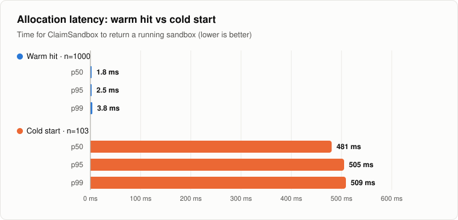
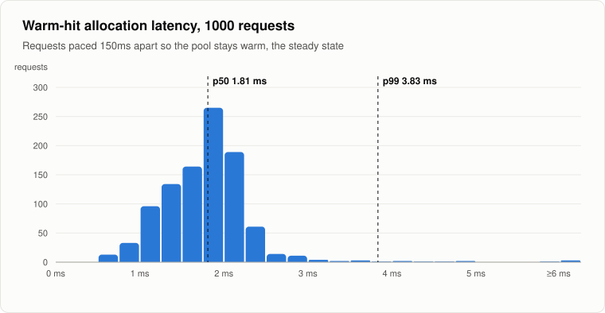
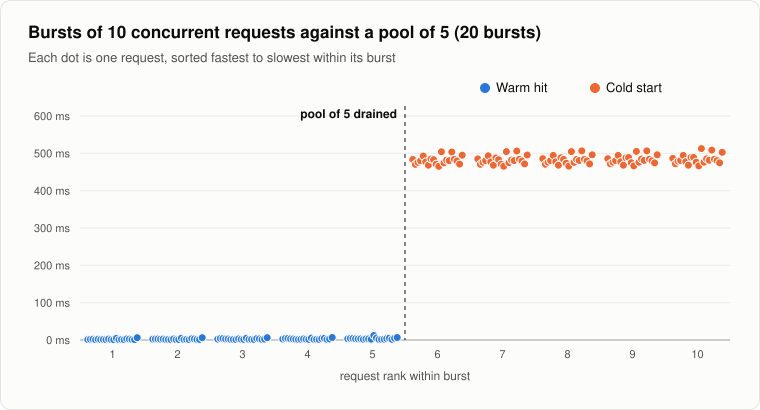
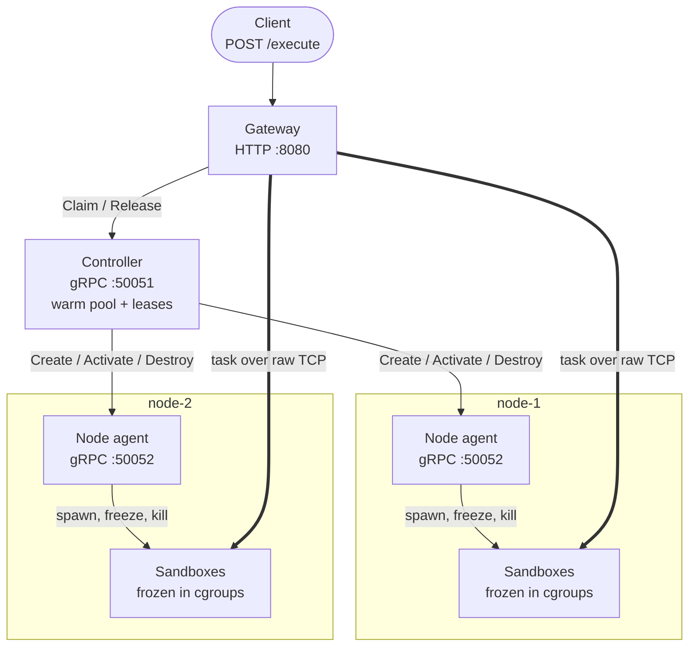
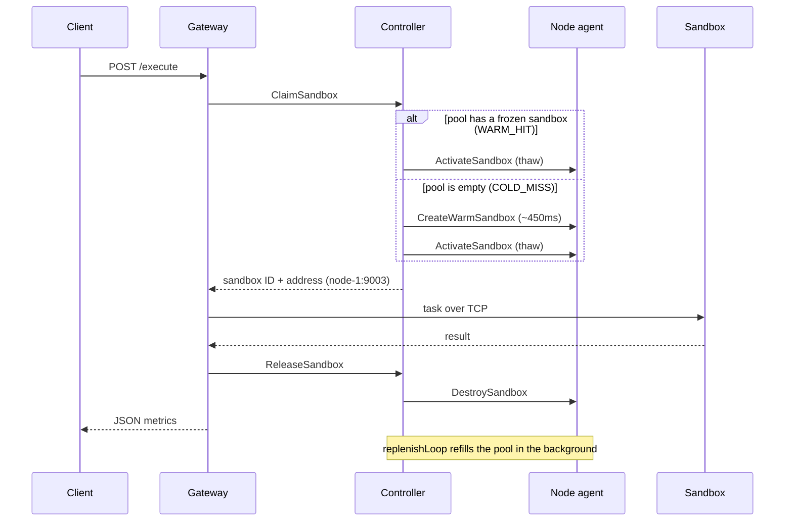

# ZeroBoot

A distributed warm pool of isolated Linux sandboxes, written in Go and gRPC.

Starting a fresh execution environment is slow: a new Python container that imports numpy and pandas takes a measured **~450ms** ([baseline](docs/cold-start-baseline.md)). ZeroBoot does that work ahead of time. Worker nodes pre-spawn sandbox processes, freeze them at 0% CPU with cgroup v2, and park them in the controller's warm pool. A request thaws one instead of starting one, which brings allocation down to **1.8ms p50 / 3.8ms p99**.

## Results

Measured with `scripts/benchmark.sh` against the four-container Docker Compose cluster on one laptop (Apple M3 Pro, Docker Desktop with Linux 6.12 and cgroup v2). Raw data: [docs/benchmark/results.csv](docs/benchmark/results.csv).

| Allocation latency | n | p50 | p95 | p99 | max |
|---|---:|---:|---:|---:|---:|
| **Warm hit** (paced, steady state) | 1,000 | 1.81 ms | 2.48 ms | 3.83 ms | 15.37 ms |
| **Cold start** (pool empty) | 103 | 480.5 ms | 505.2 ms | 508.8 ms | 512.6 ms |

<picture>
  <source media="(prefers-color-scheme: dark)" srcset="docs/images/latency-percentiles-dark.svg">
  
</picture>

Warm hits are a gRPC round trip plus a write to `cgroup.freeze`. The distribution is tight, with a small tail:

<picture>
  <source media="(prefers-color-scheme: dark)" srcset="docs/images/warm-latency-histogram-dark.svg">
  
</picture>

A burst larger than the pool never fails. The first five requests get warm sandboxes, and the rest fall back to a cold start while the pool refills in the background:

<picture>
  <source media="(prefers-color-scheme: dark)" srcset="docs/images/burst-behavior-dark.svg">
  
</picture>

Other results from the same run:

- **Every check passed.** The 5 rapid requests were all warm (1.2–1.5ms), and the 3 burst requests after them were all cold (~472ms).
- **The hung lease was cleaned up.** It was destroyed by the TTL cleanup after 11.9s: the 10s TTL plus up to one 2s cleanup tick.
- **The isolation was real.** All 1,215 sandboxes created during the run were placed in a real cgroup, with 0 signal fallbacks and 0 failed requests.
- **A full request takes longer than allocation.** End-to-end HTTP latency for a warm request is 8.3ms p50 / 12.3ms p99. That includes streaming the task over TCP and the synchronous `ReleaseSandbox`, which kills the process.
- **Concurrency adds a little.** Warm hits during a 10-request burst take 2.3ms p50 / 6.7ms p99. In the paced run, 4 of 1,000 warm hits went over 5ms.

## Architecture



Thin arrows are the **control plane** (gRPC). Thick arrows are the **data plane**: the gateway streams each task straight to its sandbox over a raw TCP socket, so payloads never pass through the controller.

| Component | Role |
|---|---|
| [`cmd/gateway`](cmd/gateway) | HTTP entry point. Claims a sandbox, streams the task over TCP (`TCP_NODELAY`, keepalive), releases it, returns JSON metrics. |
| [`cmd/controller`](cmd/controller) | Owns the warm pool, a buffered Go channel of 5 frozen sandboxes. Refills it in the background, round-robin across nodes, and destroys leases held longer than 10s. |
| [`cmd/node-agent`](cmd/node-agent) | Runs on each worker. Spawns sandboxes in new PID and UTS namespaces, puts each in its own cgroup, and freezes, thaws or kills it on request. |
| [`cmd/sandbox`](cmd/sandbox) | The workload. Simulates a 450ms cold start, then answers one line of input per line over TCP. |

### One request



Sandboxes are single-use. Release destroys the sandbox instead of returning it to the pool, so no state can leak from one task to the next.

## Running it

Requires Docker with cgroup v2 (Docker Desktop or any recent Linux). The benchmark also needs `curl` and `jq`.

```sh
docker compose up --build -d     # or: make up
curl -s -X POST localhost:8080/execute -d '{"payload": "hello"}'
```

```json
{"sandbox_id":"4ce4c231","node":"node-1","status":"WARM_HIT","allocation_latency_ms":1.354,"output":"sandbox=4ce4c231 pid=1 result=HELLO"}
```

`pid=1` shows that the sandbox runs in its own PID namespace. Add `?simulate_hang=true` to skip the release, and the controller's cleanup loop destroys the sandbox about 10s later.

```sh
./scripts/benchmark.sh                        # or: make bench (about 5 minutes)
python3 scripts/plot_benchmark.py bench-results/results.csv docs/images   # redraw charts
docker compose down                           # or: make down
```

`SAMPLES`, `INTERVAL`, `BURSTS` and `GATEWAY_PORT` override the benchmark defaults. The script exits non-zero if any check fails.

## Design notes

- **No locks on the claim path.** The warm pool is a buffered channel. A `select` with a `default` case either takes a sandbox at once or falls through to a cold start at once, so a claim never waits on the pool.
- **The refill can't overfill.** Only one goroutine starts spawns, and it keeps `len(pool) + in-flight spawns <= 5`, so a finished spawn's send into the channel never blocks.
- **The cleanup loop holds the lock briefly.** It removes expired leases under a mutex, then makes the slow `DestroySandbox` calls after releasing it.
- **Freezing uses `cgroup.freeze`.** The node agent falls back to `SIGSTOP`/`SIGCONT` where cgroups aren't writable, such as macOS during development.
- **There is no memory limit.** Setting `memory.max` inside a container runs into cgroup v2's "no internal processes" rule, and working around it was out of scope.

## Limitations

- **This is a simulation.** The sandbox fakes its startup with a 450ms sleep. Everything else is real: the processes, namespaces, cgroups, gRPC calls and TCP streams.
- **The isolation is not a security boundary.** PID and UTS namespaces and a freezer cgroup aren't enough; there is no seccomp, user namespace or filesystem isolation. Worker containers also run privileged.
- **The controller is a single point of failure.** It has one process and in-memory state, with no replication or recovery after a restart.
- **Placement is plain round robin.** It doesn't account for node load or health.
- **The benchmark runs on one machine.** All four containers share one laptop, so nothing here measures network latency between real hosts.
